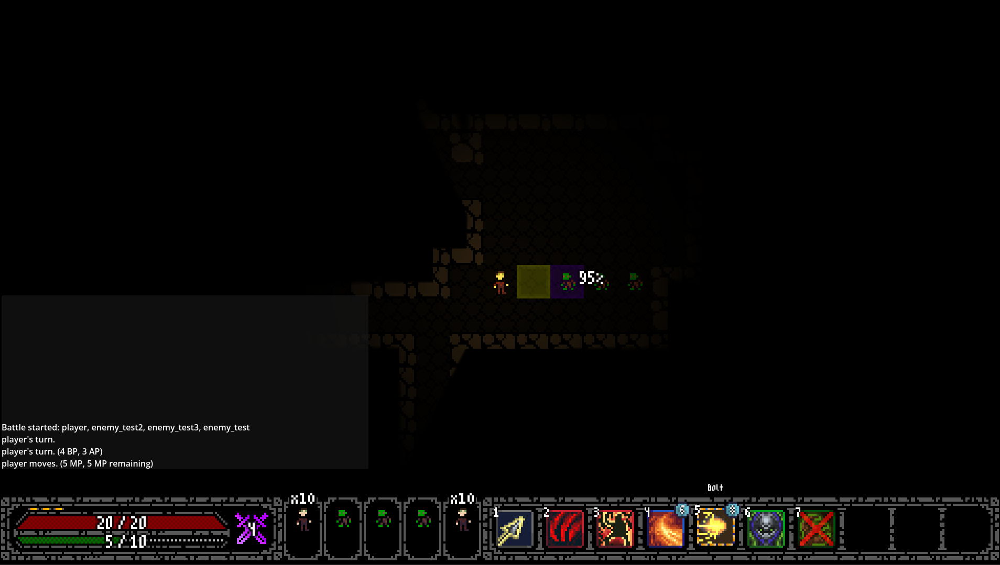

# Project Fantasy

A top-down, turn-based tactics CRPG built in Godot 4 with GDScript. Inspired by old-school Ultima's Gothic. It has grid-based exploration that drops straight into tactical combat on the same map with no separate battle screen.

This is a solo project in active development.



## Current features

**Combat**
- Speed-based initiative. Each combatant fills an accumulator after each characters turn based on their speed stat and acts when it reaches 100, meaning that fast units can take multiple turns in a row. A preview of the upcoming turns runs the same logic to visually display who's turn it currently is as well as who is coming next, meaning the display never differs from what actually happens.
- Multiple mana systems for movement as well as actions during battle, with on-screen reasons for when an action is unusable (Currently a combat log but will be replaced with more aesthetically pleasing floating text).
- Custom A* pathfinding (which extends the built-in `AStar2D`) as orthogonal steps cost 2 movement point (MP) and diagonals cost 3 MP. This was done as to not overcomplicate the on screen maths for MP calculations with half points or the actual diagonal value of 1.414.
- Hit chance, dodge, weapon damage rolls and elemental resistances are all data-driven, meaning no code changes are needed to add or change these statistics on an enemy/ally/player.
- Melee and ranged attacks, which includes projectile penetration and visibly missed shots.
- Enemies that find the nearest target and path towards it.
- Reinforcements joining mid-fight if the battle moves into their view range (be it the player or other enemies).

**Abilities**, Each a subclass of a shared `BaseAbility` with its own targeting and execution:
- **Charge**: Dash in a line, hitting everything on the way, and push the end target to another tile. If there's no room to push, it takes crush damage instead and moves to where the player started the charge.
- **Cleave**: A three-tile sweep with a small chance to kill outright.
- **Blink**: Teleport next to an enemy and strike, gaining dodge on the next attack against you.
- **Focus**: Lock onto an enemy and fire a heavy shot at the start of the next turn. Cannot act before or after using this ability.
- **Bolt**: Lightning that chains between targets with falling damage the more targets it hits.
- **Flametouch**: A melee hit that sets the target on fire.

**Status effects** Processed at the start of each turn. Fire damage that can spread to neighbours, delayed Focus shots, and Blink dodge.

**World and UI**
- Tile-based movement with a precision movement mode, collision, camera smoothing and interactable objects.
- JSON-driven dialogue system.
- Lootable containers, an inventory (currently back-end only), character sheet, journal, combat log (temporary, will be replaced with floating text), ability hotbar, turn-order cards, info panel which describes abilities and floating damage numbers.
- Shader effects for hit flashes and greyscale for locked abilities.
- Prototype skill trees (in progress).

## Architecture

The game is organised around autoloaders, each with a job of their own:

| Autoload | Responsibility |
|---|---|
| `BattleManager` | Starts and ends battles, runs the turn loop, handles reinforcements. |
| `PlayerData` | Player stats, skills and inventory. |
| `ItemDB` / `AbilityDB` / `StatDB` | Data scripts for items, abilities and stats. |
| `DialogueManager` | Loads and plays JSON dialogue. |
| `LootManager` / `InteractManager` | Containers and world interaction. |
| `CombatLog`, `CombatEffects`, `PlayerHud`, `HotbarDisplay`, `TurnOrderCards`, etc. | Combat feedback and UI. |

Design choices 
- **Data-driven.** Stats are Godot `Resource` files in `data/stats/`, loaded at start-up, so adding/changing a character stat does not require any code changes. Abilities are defined as data and paired with a unique script to extract appropriate behaviour.
- **One source of truth for turn order.** Both the live turns and the preview turns use the same function. The preview is handed a copy of the turn-order state.
- **Small, single-purpose classes for combat rules.** Turn order, status effects, pathfinding and abilities are separate `RefCounted` classes rather than logic buried in scene nodes, meaning that they are freed when nothing is pointing at them.

## Controls

| Action | Key |
|---|---|
| Move | WASD / arrow keys |
| Precise move / precision mode | Shift + Space |
| Interact | E |
| Abilities | 1–0 |
| End turn | G |
| Turn order screen | T |
| Character / Inventory (WIP) / Journal / Map (Not Implemented) | C / I / J / M |
| Menu | Tab |
| Back / cancel | Q / Esc |

## Running it

1. Install [Godot 4.7](https://godotengine.org/) (standard build, not .NET).
2. Clone this repo and open `project.godot` in Godot.
3. Press F5 to run.

## Project structure

```
assets/    Sprites, fonts and art.
data/      Stat data and dialogue JSONs.
scenes/    Levels, entities, GUI and effects.
scripts/   autoloads, combat logic, abilities and tools.
shaders/   visual effect shaders.
```

## Built with

- Godot 4.7, GDScript
- 16×16 pixel art tiles. Currently at a fixed 1920×1080 resolution, zoomed in x4. (Will have multiple resolutions and aspect ratios implemented at a later time)

## Credits

Third-party assets are used under their respective licences:

- Fonts: m5x7 and m3x6 by Daniel Linssen

## Licence

© 2026 Emanuel Rodowicz. All rights reserved.

The code is public for portfolio purposes only. Please don't reuse or redistribute it without permission.
